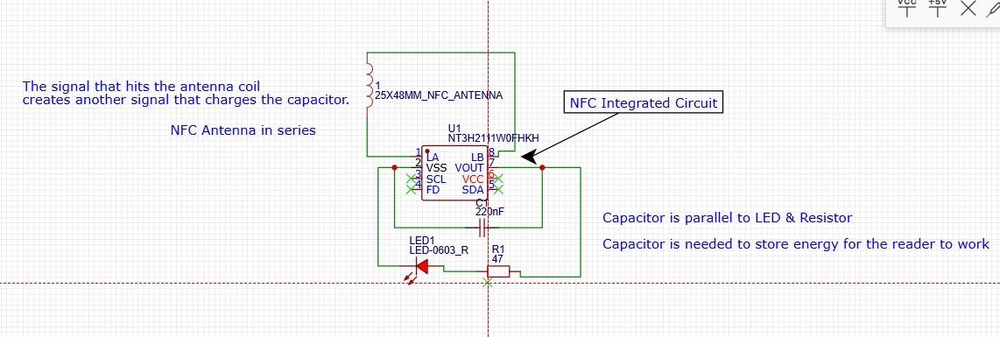
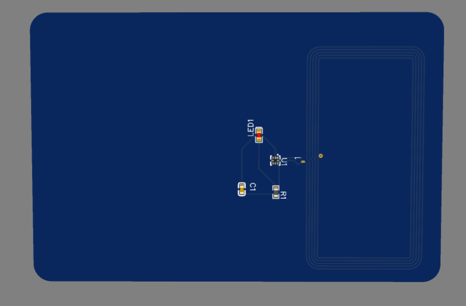
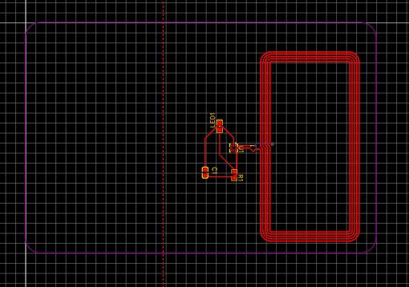
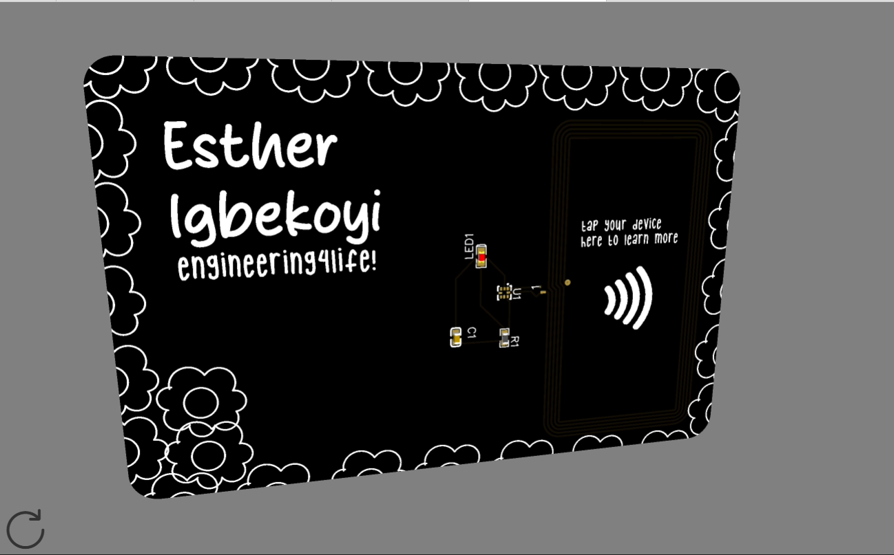
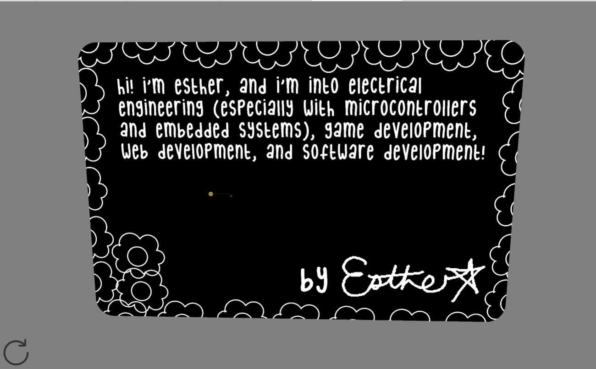
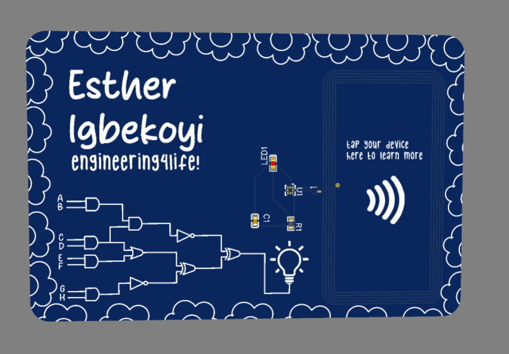
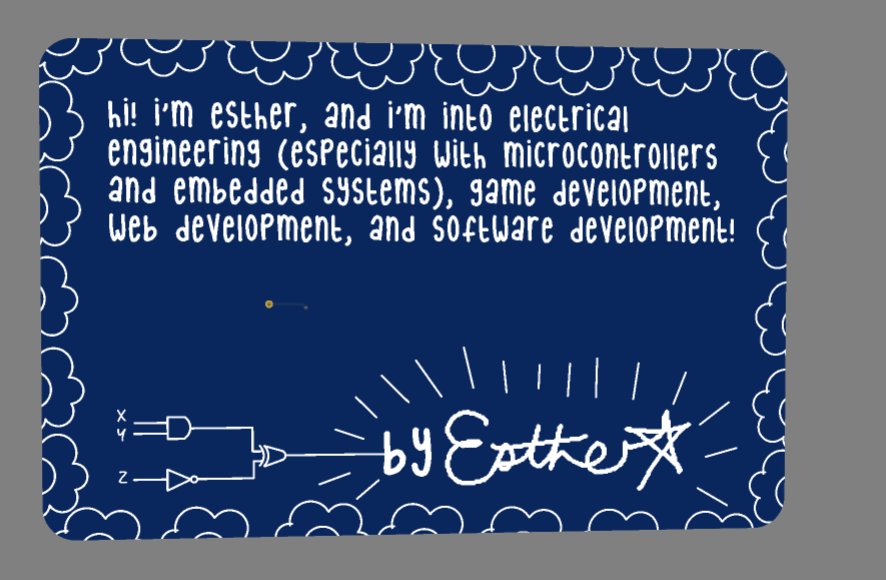

# 10/25 Session 1 (2 hours)

I finally routed the PCB and designed the circuit following the tutorial I found in EasyEDA. It only took me this long due to the
errors that the software was giving me, which I found weren't really problematic and didn't matter in the grand scheme of things :sob::v:.

To help me better understand the circuit, I've also added some comments to the schematic so I understand what the components are and what they're doing.

Here's the nearly finished (undecorated) PCB! (3D + 2D)

# 10/25 Session 2 (3 hours)

I felt my attention span dwindling the previous session (but I knew I would eventually come back) so I worked on my project for 2 sessions today.

I spent 3+ hours decorating the PCB card. I did the basic adding my name + interest, describing myself, and added a symbol for the NFC reader. However, I wanted to do something more original with the card design.

Inspired by another Hack Clubber's card, I also added my signature to the card (by Esther on the back). I also bordered the card with a flower pattern that I made with the EasyEDA software (so you can imagine it's not that perfect). The thing I'm most proud of doing was implementing logic gates in my card design.

So, the front of the PCB has XOR, AND, OR, and NOT gates that lead to a lit lightbulb. On the back, I used fewer gates to lead to my signature to make it look like the gates were making my signature light up. I'm super proud of how it turned out!

I had almost forgotten that NOT gates usually have one input and not two initially. At the beginning, I even wanted to use the logic gate circuit I created for a project I did in my Digital Electronics class last school year, but I had forgotten that multism.live was shut down, so I lost everything :<zero-width space>(.

Here are some of the photos of the progress I've done so far!

## In Progress Pictures

PCB before I decided to add the logic gates to the design!

## Current Photos

PCB currently!

