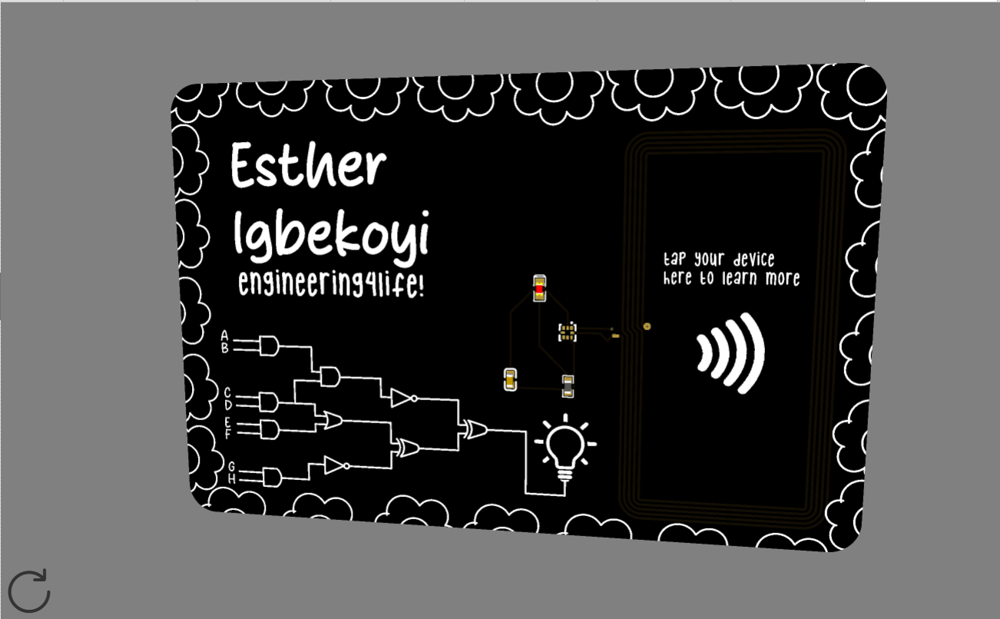
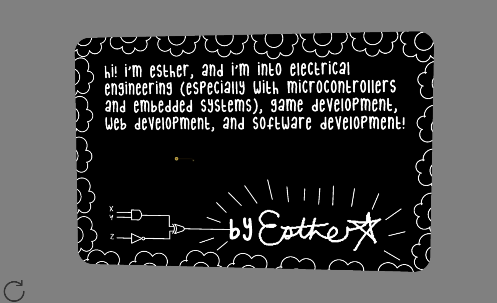

# PCB Business Card

## Overview

This is my PCB business card with a NFC reader that leads to my website. I designed it on EasyEDA!

Part of my design was inspired by digital logic gates. I have two circuits, --one on each side-- and my signature on the back + more about me.

## Why I Made This Project

I decided to make a PCB business card as a way to easily have a way to introduce myself during events. I was in the process of remaking my personal website, and I saw this project and thought it would be nice to have a way to link to it while meeting people in person as well!

## PCB Images

### Schematic

### PCB

### Front

### Back

## Credits

[Video on how to make the schematic](https://www.youtube.com/watch?v=gZiK--LwjQs&pp=0gcJCSsMAYcqIYzv)

[How to Better Understand what the Circuit Is Doing](https://www.instructables.com/PCB-Business-Card-With-NFC/)

## BOM

Name | Designator | Footprint | Quantity | Manufacturer Part | Manufacturer | Supplier	| Supplier Part | Price | Link |
------------ | ------------- | --- | ------- | ---- | ---- | ------- | ---- | ---- | --- |
25X48MM_NFC_ANTENNA| 1 | 25X48MM_NFC | 1 | 
220nF | C1 | C0603 | 1 | CL10B224KA8NNNC | SAMSUNG(三星) | LCSC | C21120 | 0.009 | https://www.lcsc.com/product-detail/C21120.html?s_z=n_q_C21120&globalKeyword=C21120
LED-0603_R | LED1 | LED0603_RED | 1 | 19-217/R6C-AL1M2VY/3T | EVERLIGHT(台湾亿光) | LCSC | C72044 | 0.021 | https://www.lcsc.com/product-detail/C2986060.html?is_substitute=1&original_product_code=C72044&original_unit_price=0.0212
47 | R1 | R0603 | 1 | 0603WAF470JT5E | UNI-ROYAL(厚声) | LCSC | C23182 | 0.002 | https://www.lcsc.com/product-detail/C23182.html?s_z=n_q_C23182&globalKeyword=C23182
NT3H2111W0FHKH | U1 | XQFN-8_L1.6-W1.6-P0.50-BL_NT3H2111W0FHKH | 1 | NT3H2111W0FHKH | NXP(恩智浦) |LCSC| C710403 | 0.564 | https://www.lcsc.com/product-detail/C710403.html?s_z=n_q_C710403&globalKeyword=C710403
PCBs from JLCPCB | | | 5 | | | | | 4.00| jlcpcb.com |
Shipping | | | | | | | | 7.54|
TOTAL | | | | | | | | 12.114|
